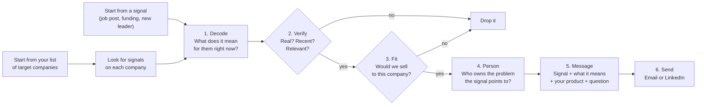

# Signal to outbound

From a buying signal to a list of companies with an email for each, ready to send. Built for the "Outreach workflows" session at GTM Tech Week Berlin, 19 November 2026, by Leszek Lammel and Mateusz Sekta.

**Start now: [START.md](START.md).** It takes 8 minutes to set up and runs while we talk.

What's in here:

- **One prompt that builds your list**, with a Clay trial or without: it finds companies with your signal, checks each one, finds the person and writes the signal email.
- **The signal email** from the ICP & messaging session, mapped to your canvas, plus notes from our copy library.
- **A buying signal library.** 30 signals: what each usually means, how long it stays fresh, and how to find it with Clay and without.
- **10 agentic workflows**, each with Clay and without, and [a page that draws your own workflow](draw/README.md) with the tools' logos.
- **A tool map** for when you want to run this every day instead of once.

## The flow

Every signal workflow is the same six steps. Only the source of the signal changes.

Step 2 is where most automated outbound goes wrong. In our demo run, a Clay search for "German software companies that posted an SDR job in the last 30 days" returned 20 companies. When we checked each posting, 9 of the 20 did not hold up: the role was in Milan, Spain, the US or China, or no open role could be found. See [demo/last-run.md](demo/last-run.md).

## Start here

**[START.md](START.md): 8 minutes.** Open Claude or ChatGPT, paste the prompt with your campaign from today, and let it run. With a Clay trial or without.

Then [finish your list](YOUR-TURN.md): check it, fix the emails, export it ready to send, and [draw your workflow](draw/README.md).

## What's inside

| Folder | What it's for |
|---|---|
| [signals/](signals/) | The library: [library.md](signals/library.md) to read, [library.csv](signals/library.csv) to give to an AI |
| [workflows/](workflows/) | 10 agentic workflows, plus how an always-on version runs |
| [copy/](copy/) | The signal email, our copy notes and the [signal-to-message prompt](copy/signal-to-message-prompt.md) |
| [demo/](demo/) | The demo, the prompts and our last run |
| [TOOLS.md](TOOLS.md) | Which tool does which job, with and without Clay |
| [START.md](START.md) | Start your run in 8 minutes |
| [YOUR-TURN.md](YOUR-TURN.md) | Finish your list in 25 minutes |
| [draw/](draw/README.md) | Draw your workflow with the tools' logos |
| [AGENTS.md](AGENTS.md) | Instructions for Claude Code and Codex when you open this repo |

## Rules that hold for every workflow

1. **Name the event and its date.** "Series A" is an attribute. "Series A announced 3 October" is a signal.
2. **Old signals are worse than none.** A one-year-old funding round in an opener tells the reader you use stale data. Check the freshness window in the library.
3. **The signal must connect to something useful you can give.** If you can't name the work it creates and how you'd help with it, skip the account.
4. **Verify before you write.** Open the link. Check the location, the date and that it's still live.
5. **Nothing gets sent automatically while you're learning.** Read every message before it goes out.

## Credits

Built by [Lammel Advisory](https://lammel.ai) with Mateusz Sekta for GTM Tech Week Berlin 2026. The demo company "Rampwise" is made up. The companies in the demo results are real and were found through public job postings on 18 and 19 November 2026; nobody was contacted.
