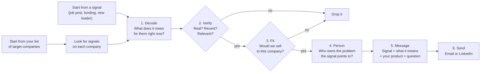

# Signal to outbound

From a buying signal to a message someone wants to answer. Built for the "Outreach workflows" session at GTM Tech Week Berlin, 19 November 2026, by Leszek Lammel and Mateusz Sekta.

What's in here:

- **A buying signal library.** 30 signals. For each one: what it usually means, how long it stays fresh, how to find it with Clay and without, and how to turn it into a message.
- **10 agentic workflows.** The same pattern applied to different signals, each shown with Clay and without.
- **3 copywriting frameworks** and one prompt that teaches your AI to connect a signal to what your product does.
- **A demo you can run in 10 minutes** in Claude, ChatGPT, Claude Code or Codex.
- **A tool map** for when you want to run this every day instead of once.

## The flow

Every signal workflow is the same six steps. Only the source of the signal changes.

Step 2 is where most automated outbound goes wrong. In our demo run, a Clay search for "German software companies that posted an SDR job in the last 30 days" returned 20 companies. When we checked each posting, 9 of the 20 did not hold up: the role was in Milan, Spain, the US or China, or no open role could be found. See [demo/last-run.md](demo/last-run.md).

## Start here

| You have | Do this |
|---|---|
| Claude or ChatGPT, plus a Clay account | Connect Clay ([setup](demo/README.md#path-a-claude-or-chatgpt-with-clay)), then paste [the Clay demo prompt](demo/prompt-with-clay.md) |
| Claude or ChatGPT, no Clay | Paste [the no-tools demo prompt](demo/prompt-no-tools.md). It uses web search only |
| Claude Code or Codex | Clone this repo, open it, and type `run the demo` |
| Nothing works | Open [demo/practice-companies.csv](demo/practice-companies.csv) and do the steps by hand with any chatbot |

Then do [your turn](YOUR-TURN.md): the same flow for your own product.

## What's inside

| Folder | What it's for |
|---|---|
| [signals/](signals/) | The library: [library.md](signals/library.md) to read, [library.csv](signals/library.csv) to give to an AI |
| [workflows/](workflows/) | 10 agentic workflows, plus how an always-on version runs |
| [copy/](copy/) | 3 frameworks and the [signal-to-message prompt](copy/signal-to-message-prompt.md) |
| [demo/](demo/) | The 10-minute demo, the prompts and our last run |
| [TOOLS.md](TOOLS.md) | Which tool does which job, with and without Clay |
| [YOUR-TURN.md](YOUR-TURN.md) | The 30-minute exercise |
| [AGENTS.md](AGENTS.md) | Instructions for Claude Code and Codex when you open this repo |

## Rules that hold for every workflow

1. **Name the event and its date.** "Series A" is an attribute. "Series A announced 3 October" is a signal.
2. **Old signals are worse than none.** A one-year-old funding round in an opener tells the reader you use stale data. Check the freshness window in the library.
3. **The signal must connect to what you sell.** If you can't say why this event makes your product more relevant now, skip the account.
4. **Verify before you write.** Open the link. Check the location, the date and that it's still live.
5. **Nothing gets sent automatically while you're learning.** Read every message before it goes out.

## Credits

Built by [Lammel Advisory](https://lammel.ai) with Mateusz Sekta for GTM Tech Week Berlin 2026. The demo company "Rampwise" is made up. The companies in the demo results are real and were found through public job postings on 18 and 19 November 2026; nobody was contacted.
