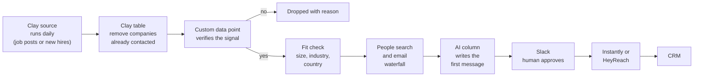
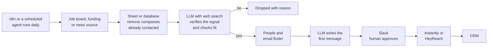

# Tools for each step

Today you run everything by hand in a chat. This page is for later: what to use when you want the same workflow to run every day.

**Start by hand.** Run one signal manually for a couple of weeks, about 20 companies a week. Automate it only once you know the signal gets replies.

## One tool per job

| Job | With  Clay | Without Clay |
|---|---|---|
| Find companies with a signal |  Clay company search: job posts, new hires, headcount growth, tech stack, funding | Your AI with web search; careers pages and job boards ( Ashby,  Greenhouse,  Personio,  LinkedIn Jobs, StepStone);  Crunchbase or  Dealroom for funding;  BuiltWith or  Wappalyzer for tech stack |
| Verify the signal | A Custom data point ( Clay's research agent reads the source) | Your AI opens and reads the source page |
| Check fit |  Clay company data (size, industry, location), plus a Custom data point for anything else |  LinkedIn company page and website, read by your AI |
| Find the person |  Clay people search |  LinkedIn Sales Navigator, or LinkedIn search through your AI |
| Find the email |  Clay's email waterfall (it tries several providers in turn) | An email finder such as  Prospeo,  Findymail,  Hunter or  Apollo |
| Write the message | Your AI in chat, or an AI column in a  Clay table | Your AI with [the signal-to-message prompt](copy/signal-to-message-prompt.md) |
| Approve before sending | A  Slack message with the signal, the link and the draft | Same |
| Send email |  Instantly,  Smartlead or  lemlist | Same |
| Send on  LinkedIn |  HeyReach or  lemlist | Same |
| Track replies and deals | Your CRM:  HubSpot,  Attio,  Pipedrive | Same |
| Run it on a schedule |  Clay scheduled sources and webhooks |  n8n or  Make, or a scheduled  Claude Code or  Codex agent |

## At scale, with Clay

## At scale, without Clay

## What changes at scale

- **Dedupe first.** Signals repeat: the same company posts the same job every month. Check against everyone you've already contacted before you spend anything on research.
- **Keep the evidence link with the row.** The person approving needs it, and so does whoever reads the reply.
- **Watch the drop rate.** If more than half the companies fail verification, fix the search, not the verification.
- **Rewrite nothing by hand at scale.** If you keep editing the same thing in the drafts, change the prompt.
