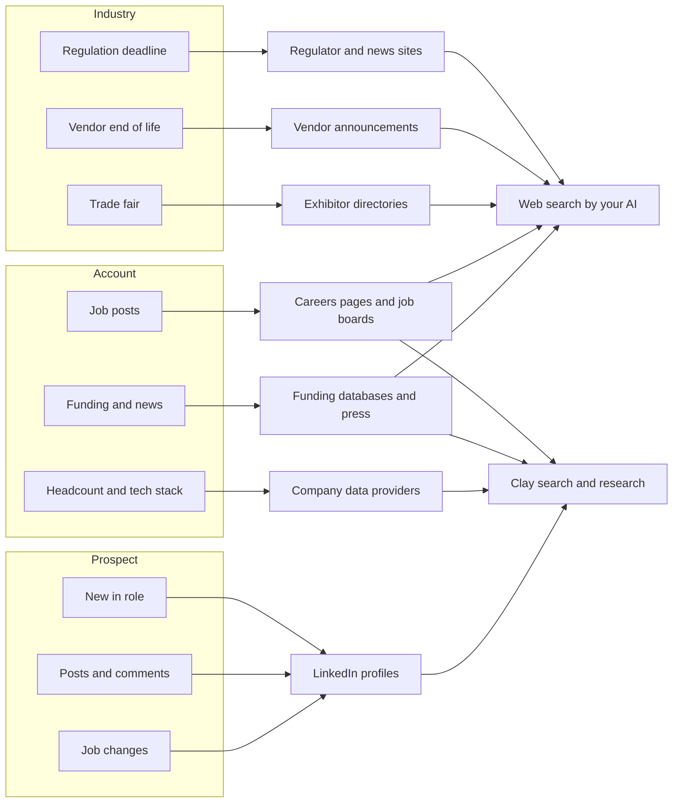

# Buying signals

A buying signal is something you can observe that makes a company more likely to need what you sell **now**. Fit tells you who could buy. A signal tells you when.

- [library.md](library.md): 30 signals to read.
- [library.csv](library.csv): the same 30 to upload to your AI.

## Three levels

| Level | What changes | Example | How you use it |
|---|---|---|---|
| **Industry** | Something hits a whole segment at once | A regulation deadline, a vendor shutting down a product | Message every company in the segment, prioritised by account signals |
| **Account** | Something changes at one company | A job post, a funding round, a new market | Find the company, then the person who owns the problem |
| **Prospect** | Something changes for one person | New in the role, posted about the problem, changed jobs | Write to that person about what changed for them |

The strongest accounts have signals on more than one level. Two examples:
- An SDR job post plus an SDR leader who started 4 months ago.
- A regulation deadline plus a job post for a compliance manager.

## Where signals come from and how you catch them

## Two properties to check before you use a signal

**Type.** We sort signals into three types:
- **Trigger:** an event with a date that opens a buying window, such as funding or a new leader.
- **Leading:** activity that points toward a purchase, such as a job post or a tool change.
- **Structural:** fit with no timing, such as using a certain tool. Structural alone is not a reason to write today.

**Freshness.** Every signal decays. A funding round is strong for about 90 days and useless after a year. A job post is strongest in its first 30 days. Mentioning an expired signal tells the reader you use old data. Each signal in the library has its own window.

## Pitch or touchpoint

This split comes from Mateusz's part of the session.

- **Pitch:** the signal is itself a reason to buy what you sell. You can name the problem and your offer in the first message. An SDR job post is a pitch for an SDR ramp program.
- **Touchpoint:** the signal is a reason to talk, not proof of need. Open a conversation, give something useful, and pitch later. A funding round is a touchpoint for most sellers.

The same signal can be a pitch for one product and a touchpoint for another. The library says which it usually is. Your product decides.
