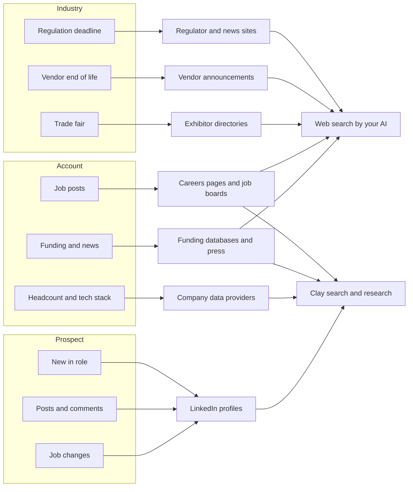

# Buying signals

A buying signal is something you can observe that makes a company more likely to need what you sell **now**. Fit tells you who could buy. A signal tells you when.

- [library.md](library.md): 30 signals to read.
- [library.csv](library.csv): the same 30 to upload to your AI.

## Three levels

| Level | What changes | Example | How you use it |
|---|---|---|---|
| **Industry** | Something hits a whole segment at once | A regulation deadline, a vendor shutting down a product | Message every company in the segment, prioritised by account signals |
| **Account** | Something changes at one company | A job post, a funding round, a new market | Find the company, then the person who owns the problem |
| **Prospect** | Something changes for one person | New in the role, posted about the problem, changed jobs | Write to that person about what changed for them |

The strongest accounts have signals on more than one level. Two examples:
- An SDR job post plus an SDR leader who started 4 months ago.
- A regulation deadline plus a job post for a compliance manager.

## Where signals come from and how you catch them

## Two properties to check before you use a signal

**Type.** We sort signals into three types:
- **Trigger:** an event with a date that opens a buying window, such as funding or a new leader.
- **Leading:** activity that points toward a purchase, such as a job post or a tool change.
- **Structural:** fit with no timing, such as using a certain tool. Structural alone is not a reason to write today.

**Freshness.** Every signal decays. A funding round is strong for about 90 days and useless after a year. A job post is strongest in its first 30 days. Mentioning an expired signal tells the reader you use old data. Each signal in the library has its own window.

## Pitch or touchpoint

This split comes from Mateusz's part of the session.

- **Pitch:** the change itself makes your offer relevant. Name the change and what you can give them. An SDR job post is a pitch for an SDR ramp program.
- **Touchpoint:** the change doesn't show a need. Use it to choose whom to write to, then offer something useful about the work you can see, without claiming they have a problem. A funding round is a touchpoint for most sellers.

The same signal can be a pitch for one product and a touchpoint for another. The library says which it usually is. Your product decides. Either way, the message follows [the copy notes](../copy/README.md).

## Other public libraries

Many people have shared bigger lists. We opened each of these on 19 November 2026. All open without an email unless noted.

| Library | Size | What it adds |
|---|---|---|
| [Common Room, 100 Signals for Pipeline Generation](https://docs.google.com/spreadsheets/d/1svg00iIOZlYDwBsmSPFFBsw-CMUwvJ4xi2l6mwquH8s/edit) (Google Sheet) | 102 signals | The original most later lists borrow from. Strong on product-led and community signals, thin on timing. The [web version](https://www.commonroom.io/resources/signals/) has a full guide with example messages for 39 of them. |
| [Swan, Ultimate GTM Signal Library](https://sdrgpt.notion.site/the-swan-ai-ultimate-gtm-signal-library) (Notion) | 83 | Every row names a source you can use yourself and how fast to act. |
| [RevOps Lab, buying signals](https://revopslab.org/signals/) | 112 | How long each signal lasts and how strong it is. |
| [salesCraft and lemlist, 95 Buying Signals](https://intent-signals-outbound-playbook.netlify.app/) | 94 | A message template and a worked example for every signal. Generic, but the closest to signal-to-message. |
| [Growleads, The Complete List of B2B Buying Signals](https://growleads.io/blog/buying-signals-b2b/) | 103 | Signals worded with the fit filter built in, such as a sales leader hired in the past 90 days at a company that fits. |
| [ZoomInfo, GTM Plays and Signals](https://airtable.com/appGc0v7TfWslJP7L/shrX0gSEGYdasEu58/tblBOqYAGCSL9bVRC) (Airtable) | 60 plays | The most detail per play: steps, channels and an AI prompt. Much of it assumes ZoomInfo data. |
| [La Growth Machine, 84 Buying Signals](https://lagrowthmachine.com/buying-signals-guide/) | 84 | An opening line per signal, and 8 signals that mean "don't write now". The first 10 are open, the rest need an email. |
| [Scale Intelligence, buying signals](https://www.scaleintelligence.dev/blog/buying-signals) | 27 | Each one tied to a public record you can check: company filings, layoff notices, public tenders. |
| [SalesOne, trigger events](https://salesone.now/learn/trigger-events-in-sales) | 24 | A time window, a free source and who usually owns the problem, for each. |

The Common Room sheet link shared in many LinkedIn posts no longer works. The one above does: make a copy to use it.

How ours differs: it is shorter on purpose. 30 signals, each with an angle for the first message and a way to find it with Clay and without, so you can run one today.

