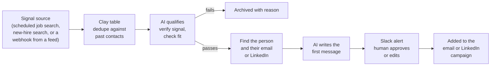

# 10 agentic signal workflows

Every workflow below is the same six steps from the [main flow](../README.md#the-flow): decode, verify, fit, person, message, send. What changes is where the signal comes from and who you write to.

Each one can run two ways:

- **With Clay:** your AI uses the Clay connector to search and research.
- **Without Clay:** your AI uses web search and the sources named.

For each workflow: the signal, where you start, the steps, and what makes it work.

| # | Workflow | Starts from | Signals | Runs |
|---|---|---|---|---|
| 1 | [Hiring for the team you serve](#1-hiring-for-the-team-you-serve) | Signal | A1, A2 | Daily |
| 2 | [New decision maker](#2-new-decision-maker) | Signal | P1, A11 | Daily |
| 3 | [Fresh funding plus a second signal](#3-fresh-funding-plus-a-second-signal) | Signal | A5 + A1 or A4 | Weekly |
| 4 | [Champion changed jobs](#4-champion-changed-jobs) | Your customer list | P2 | Weekly |
| 5 | [Expansion into a new country](#5-expansion-into-a-new-country) | Signal | A6 | Weekly |
| 6 | [Competitor displacement](#6-competitor-displacement) | Your target list | A10 + I3, A16 | Weekly |
| 7 | [Regulation deadline](#7-regulation-deadline) | The segment | I1 + A1 | Monthly |
| 8 | [Events: exhibitors and attendees](#8-events-exhibitors-and-attendees) | The exhibitor list and posts about the event | I5 | Per event |
| 9 | [People talking about the problem](#9-people-talking-about-the-problem) | LinkedIn posts | P4, P5 | Daily |
| 10 | [Your target list, re-checked weekly](#10-your-target-list-re-checked-weekly) | Your target list | Any 3 to 5 | Weekly |

---

## 1. Hiring for the team you serve

The signal we used in the demo. We run it as an always-on campaign for clients.

- **Signal:** the company posted a job for the team your product serves ([A1](../signals/library.md#a1-a-job-post-for-the-function-you-serve)). Even better, the job description names a tool or problem you solve ([A2](../signals/library.md#a2-a-job-post-that-names-a-tool-or-a-problem)).
- **Start from:** the signal.
- **Steps:**
  1. Search for companies in your segment with that role posted in the last 30 days.
  2. Verify each posting: location, date, still open.
  3. Check fit.
  4. Find the leader of that team, not the recruiter.
  5. Message: the posting, and what you can prepare for the work it creates.
- **With Clay:** company search with `jobs.exists(...)`, then a Custom data point to verify, then contact search. See [the demo prompt](../demo/prompt-with-clay.md).
- **Without Clay:** start from job boards that show dates (in Germany, arbeitnow.com), then open each posting on the company's own careers page. For companies on Ashby, `https://api.ashbyhq.com/posting-api/job-board/<company>` gives every open job with its publish date.
- **What makes it work:** offering the hiring manager something for the work the hire creates (a practice call, a starting list, a setup), without claiming they have a problem.

## 2. New decision maker

Our other always-on campaign.

- **Signal:** someone started in a role that buys what you sell in the last 3 months ([P1](../signals/library.md#p1-new-in-the-role-first-90-days), [A11](../signals/library.md#a11-a-new-executive-joined-the-company-ceo-cro-cmo-cfo)).
- **Start from:** the signal.
- **Steps:**
  1. Search for companies in your segment where that title has a start date in the last 3 months.
  2. Verify that the person is really new at this company, not in the role at another one.
  3. Check fit.
  4. Write to the new person.
- **With Clay:** company search with `people.exists(is_current = true and job_title is_similar_to ("...") and start_date >= today() - interval 3 months)`, then contact search with the same filter at those companies.
- **Without Clay:** LinkedIn Sales Navigator's "changed jobs in the past 90 days" filter, or LinkedIn "started a new position" posts.
- **What makes it work:** the start date picks whom to write to; the message is about their customers or a task you can see. Our best-performing new-hire email offered a demo campaign aimed at the new leader's customers. After 6 months the window is mostly closed.

## 3. Fresh funding plus a second signal

- **Signal:** a funding round in the last 90 days ([A5](../signals/library.md#a5-a-funding-round)) plus a job post or headcount growth that points at your area ([A1](../signals/library.md#a1-a-job-post-for-the-function-you-serve), [A4](../signals/library.md#a4-headcount-grew-20-or-more-in-6-months)).
- **Start from:** the signal.
- **Steps:**
  1. Find recent rounds in your segment.
  2. For each company, look for the second signal.
  3. Keep only companies with both.
  4. Write about the second signal and use the round as context.
- **With Clay:** run a company search for your segment with a job filter, then add the Latest Funding data point and keep rounds from the last 90 days.
- **Without Clay:** ask your AI for rounds in your segment and region from the last 60 days (Crunchbase, Dealroom, Tech.eu, EU-Startups), then check each company's careers page.
- **What makes it work:** not leading with "congrats on the round". Every vendor sends that. The second signal tells you what they will spend it on.

## 4. Champion changed jobs

- **Signal:** someone who used or bought your product at a customer moved to a new company in the last 90 days ([P2](../signals/library.md#p2-a-past-champion-changed-companies)).
- **Start from:** your own customer list.
- **Steps:**
  1. List the people who used or bought your product.
  2. Check where they work now.
  3. Keep those who moved recently to a company that fits.
  4. Write to them personally.
- **With Clay:** contact search with your customers' domains, `companyTenure: "past"` and a start date in the last 3 months.
- **Without Clay:** save your past users as leads in Sales Navigator and watch for job-change alerts, or have your AI check their LinkedIn profiles monthly.
- **What makes it work:** they already know you and your product, and most teams never set it up.

## 5. Expansion into a new country

- **Signal:** the company is hiring or opening an office in a country where it didn't operate before ([A6](../signals/library.md#a6-expansion-to-a-new-country-or-a-new-office)).
- **Start from:** the signal.
- **Steps:**
  1. Search your segment for job posts located in the new country.
  2. Verify it's new for them, not an existing office.
  3. Find the person leading the expansion: often the country manager or the first hire there.
  4. Write to them.
- **With Clay:** company search with `jobs.exists(location contains "[country]" and job_posted_date >= today() - interval 60 days)`, then a Custom data point: "Has this company announced expansion into [country]?"
- **Without Clay:** press releases and job boards in that country.
- **What makes it work:** offering something specific to the new market: local knowledge, local contacts, local language.

## 6. Competitor displacement

- **Signal:** the company uses a competitor ([A10](../signals/library.md#a10-uses-a-competitor-or-a-complementary-tool)) and something just happened: the competitor changed pricing or was acquired ([I3](../signals/library.md#i3-a-competitor-shuts-down-is-acquired-or-raises-prices)), or people at the company complained about it ([A16](../signals/library.md#a16-public-complaints-about-their-current-vendor)).
- **Start from:** your target list, filtered to companies using the competitor.
- **Steps:**
  1. Find companies in your segment using the competitor.
  2. Wait for a timing signal.
  3. Write only to those with one.
- **With Clay:** company search with `technographics.any(vendor = "[competitor]")`, then a Custom data point for complaints or recent changes.
- **Without Clay:** BuiltWith or Wappalyzer, the competitor's customer logos, G2 and Reddit.
- **What makes it work:** patience. Using a competitor is fit, not timing. Writing to every user of a competitor on day one is just a bigger spray.

## 7. Regulation deadline

- **Signal:** a rule with a fixed deadline applies to a whole segment ([I1](../signals/library.md#i1-a-regulation-with-a-deadline-applies-to-the-segment)).
- **Start from:** the segment.
- **Steps:**
  1. Define who is in scope.
  2. Build the list.
  3. Rank the companies by an account signal that shows they started: a job post for a compliance or security role ([A1](../signals/library.md#a1-a-job-post-for-the-function-you-serve)), or public statements.
  4. Write first to those who started, because they have budget and an owner. Write later to those who haven't.
- **With Clay:** company search by industry, size and country, then a jobs filter or a Custom data point: "Is this company preparing for [regulation]?"
- **Without Clay:** the regulator's scope rules, industry association member lists, careers pages.
- **What makes it work:** the deadline is the same for everyone, so the message has to say something specific about this company's situation.

## 8. Events: exhibitors and attendees

- **Signal:** the company exhibits at an event your buyers attend, or its people are going ([I5](../signals/library.md#i5-a-trade-fair-or-conference-the-segment-attends)).
- **Start from:** the exhibitor list, and posts about the event.
- **Steps:**
  1. Get the exhibitor directory from the event website.
  2. Find attendees without sponsoring: speakers, and people who post that they are going or comment on the event's posts in the weeks before it.
  3. Filter both lists to your segment.
  4. Find the person: for exhibitors, whoever runs the event or owns the area you sell into; for attendees, usually the person who posted.
  5. Write 2 to 3 weeks before the event with a reason to meet there.
- **With Clay:** paste the exhibitor list into the chat, then use a Custom data point per company ("What is this company presenting at [event]?") and contact search. For attendees, a Custom contact data point that asks whether this person posted about the event.
- **Without Clay:** ask your AI to read the exhibitor directory and the speaker page, then search LinkedIn posts from the past month that name the event.
- **What makes it work:** a concrete meeting point (hall, stand, session, time) and a reason that isn't "let's grab a coffee".

## 9. People talking about the problem

- **Signal:** someone posted about the problem you solve ([P4](../signals/library.md#p4-posted-about-the-problem-you-solve)), or engaged with posts about it ([P5](../signals/library.md#p5-engaged-with-posts-about-the-problem-or-a-competitor)).
- **Start from:** LinkedIn posts.
- **Steps:**
  1. Find recent posts on the topic.
  2. Collect the author and the people who commented.
  3. Check that their company fits.
  4. Write within a week, quoting their point.
- **With Clay:** the Find Thought Leadership contact data point, or a Custom contact data point that asks for recent posts on the topic. Then use Clay to check the company.
- **Without Clay:** LinkedIn post search filtered to the past week, then open the comments.
- **What makes it work:** speed and specifics. A reply that quotes their exact point within days reads like a conversation. A month later it reads like automation.

## 10. Your target list, re-checked weekly

- **Signal:** any 3 to 5 signals from the library that fit your product.
- **Start from:** the 200 to 2,000 companies you already want as customers.
- **Steps:**
  1. Once a week, check every company on your list for each signal.
  2. Write only to companies where something changed since last week.
  3. Leave the rest alone until something does.
- **With Clay:** keep your list in a Clay table with the data points as columns and re-run them weekly. This is the one workflow where a table pays off.
- **Without Clay:** an agent in Claude Code or Codex that reads your list, checks each signal with web search and writes a short report of what changed.
- **What makes it work:** you stop writing to everyone every month and start writing to the 5% with a reason this week.

## More examples

Clay published its own list of 10 workflows GTM engineers are building with Clay, with recorded sessions at [clay.com/livestreams](https://www.clay.com/livestreams). Finding conference attendees without sponsoring is our workflow 8. Others worth a look:

- Turning event lists into invites for a small VIP dinner.
- Finding warm accounts already in your CRM.
- Working out your ideal customer from your best customers.
- Keeping lead scores current, with fewer AI calls per score.
- Launching signal campaigns from Slack.
- Turning buying signals into targeted ads.

---

## How an always-on version runs

This is the shape of the always-on campaigns we run for clients (workflows 1 and 2). It runs without a human until the approval step.

Two design choices matter:

1. **Qualification is a judgement, not a filter.** An AI reads the evidence and decides, with a written reason. Keyword filters drop good accounts and keep bad ones.
2. **A human approves before anything is sent**, at least until you trust it. The Slack alert carries the signal, the evidence link and the draft message, so approving takes seconds.

To run it at scale, see [TOOLS.md](../TOOLS.md).
